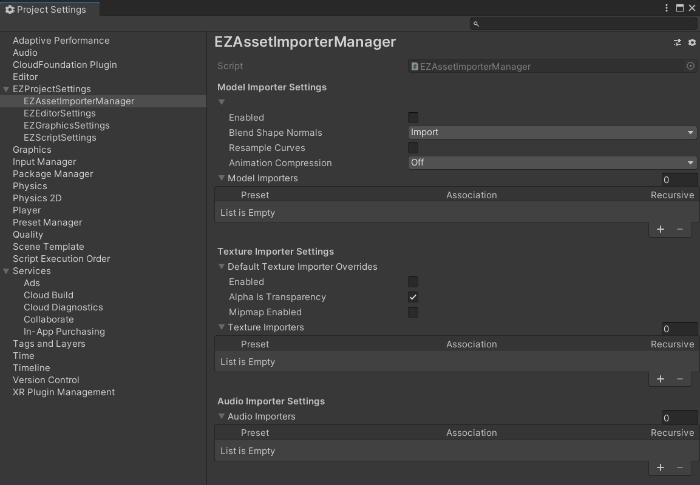
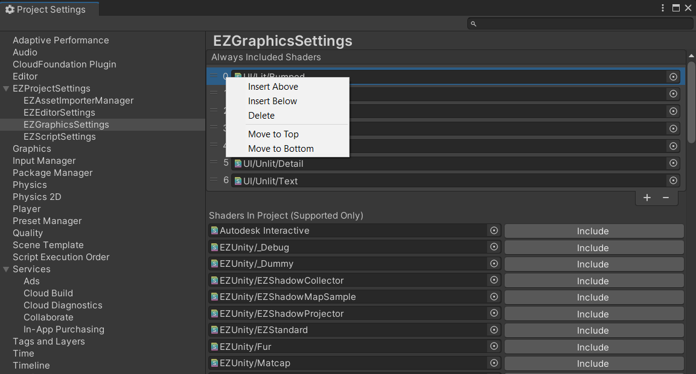

# EZProjectSettings

[English](README_EN.md)

EZProjectSettings 是 Unity 编辑器的项目设置扩展。

最低支持 Unity 版本：`2020.3.x`。

设置面板位于 `Edit > Project Settings > EZProjectSettings`。

## 设置

- `EZAssetImporterManager`：资源导入器 Preset 设置，并支持自动应用 Preset。
- `EZGraphicsSettings`：提供更加方便的界面管理 Graphics Settings 中的 Always Included Shaders。

### EZAssetImporterManager

用于统一管理 Model、Texture 和 Audio Importer 的导入设置。可以为不同类型的资源配置默认导入选项，并通过 Preset 和文件名 Tag 建立关联；资源导入时会按照当前目录到父级目录的顺序查找匹配的 Preset，并自动应用设置。



### EZGraphicsSettings

提供管理 Always Included Shaders 的工具，可以从项目中搜索并添加 Shader，也可以移除已包含的 Shader。



## 目录结构

```text
EZProjectSettings/
├── README.md — 模块说明文档。
├── README_EN.md — English module documentation.
├── Documentation~/Images/ — README 和示例图片。
└── Editor/
    ├── EZProjectSettingsProviders.cs — 注册 Project Settings Providers。
    ├── EZhex1991.EZProjectSettings.Editor.asmdef — 定义编辑器程序集。
    ├── Common/
    │   ├── EZEditorGUIUtility.cs — 提供设置 Inspector 使用的通用 GUI 辅助方法。
    │   └── EZEditorUtility.cs — 提供设置 Inspector 使用的编辑器资源查询方法。
    └── ProjectSettings/
        ├── _EZProjectSettings.cs — 项目设置单例的加载和保存基础实现。
        ├── EZAssetImporterManager.cs — 资源导入器 Preset 配置。
        ├── EZAssetImporterManagerInspector.cs — 资源导入器配置 Inspector。
        ├── EZAssetPostprocessor.cs — 自动应用资源导入 Preset。
        └── EZGraphicsSettings.cs — Project Settings 中的 Graphics 设置。
```
