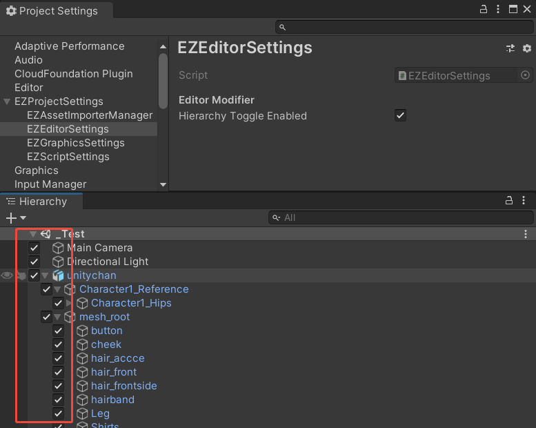
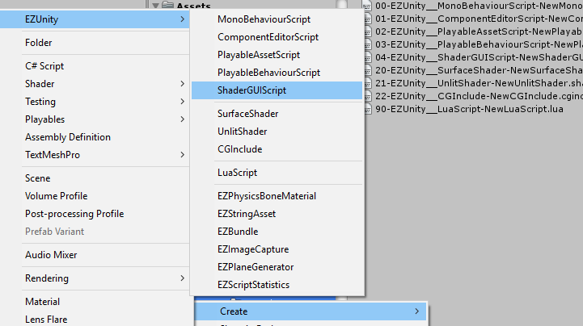

# EZProjectSettings

[English](README_EN.md)

EZProjectSettings 是 Unity 编辑器的项目设置扩展。

最低支持 Unity 版本：`2020.3.x`。

设置面板位于 `Edit > Project Settings > EZProjectSettings`。

## 设置

- `EZEditorSettings`：编辑器设置和 Hierarchy 扩展。
- `EZScriptSettings`：脚本模板和文件头处理设置。
- `EZAssetImporterManager`：资源导入器 Preset 设置，并支持自动应用 Preset。
- `EZGraphicsSettings`：提供更加方便的界面管理 Graphics Settings 中的 Always Included Shaders。

## 示例

示例内容可以通过 **Window > Package Manager > EZProjectSettings > Samples** 导入。

### EZEditorSettings

- `Hierarchy Toggle Enabled`：在 Hierarchy 窗口中显示 Active Toggle，可在不改变 `Selection.activeObject` 的情况下启用或关闭 GameObject。



### EZAssetImporterManager

用于统一管理 Model、Texture 和 Audio Importer 的导入设置。可以为不同类型的资源配置默认导入选项，并通过 Preset 和文件名 Tag 建立关联；资源导入时会按照当前目录到父级目录的顺序查找匹配的 Preset，并自动应用设置。


### EZGraphicsSettings

提供管理 Always Included Shaders 的工具，可以从项目中搜索并添加 Shader，也可以移除已包含的 Shader。


### EZScriptSettings

用于在编辑器中管理 Unity 脚本模板。Unity 的脚本模板位于 Unity 安装目录的 `Editor/Resources/ScriptTemplates` 中，导入示例后可以在设置面板中管理这些模板。



打开 `Edit > Project Settings > EZProjectSettings > EZScriptSettings`，然后在 Project 窗口中选中符合后缀规则的 TextAsset，即可将模板添加到 Unity 的脚本模板目录。模板文件名中的 `#SCRIPTNAME#` 会被替换为新脚本名称，`#CREATETIME#` 会被替换为创建时间，也可以在 Custom Pattern 中定义其他变量。


示例中的脚本模板位于 `Samples~/Demo/ScriptTemplates`。

## 目录结构

```text
EZProjectSettings/
├── README.md — 模块说明文档。
├── README_EN.md — English module documentation.
├── Documentation~/Images/ — README 和示例图片。
├── Samples~/Demo/ScriptTemplates/ — 脚本模板示例。
└── Editor/
    ├── EZProjectSettingsProviders.cs — 注册 Project Settings Providers。
    ├── EZhex1991.EZProjectSettings.Editor.asmdef — 定义编辑器程序集。
    ├── Common/
    │   ├── EZEditorGUIUtility.cs — 提供设置 Inspector 使用的通用 GUI 辅助方法。
    │   └── EZEditorUtility.cs — 提供设置 Inspector 使用的编辑器资源查询方法。
    └── ProjectSettings/
        ├── _EZProjectSettings.cs — 项目设置单例的加载和保存基础实现。
        ├── EZEditorSettings.cs — 编辑器设置和 Hierarchy 扩展。
        ├── EZScriptSettings.cs — 脚本模板和文件头替换设置。
        ├── EZScriptSettingsEditor.cs — 脚本设置 Inspector。
        ├── EZScriptProcessor.cs — 脚本创建时的文件头处理器。
        ├── EZAssetImporterManager.cs — 资源导入器 Preset 配置。
        ├── EZAssetImporterManagerInspector.cs — 资源导入器配置 Inspector。
        ├── EZAssetPostprocessor.cs — 自动应用资源导入 Preset。
        └── EZGraphicsSettings.cs — Project Settings 中的 Graphics 设置。
```
