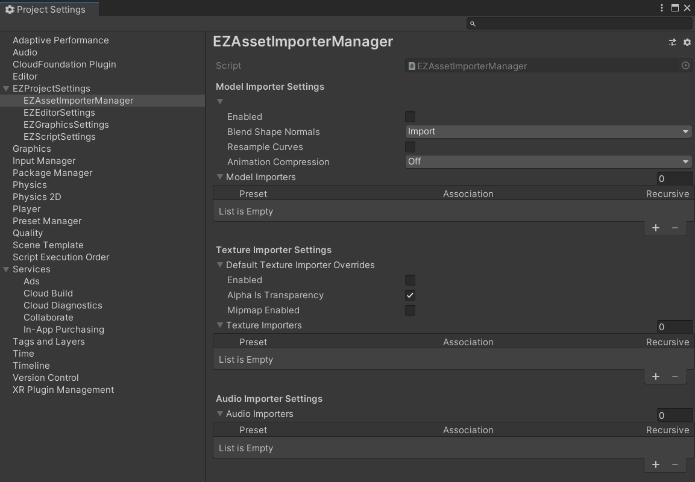
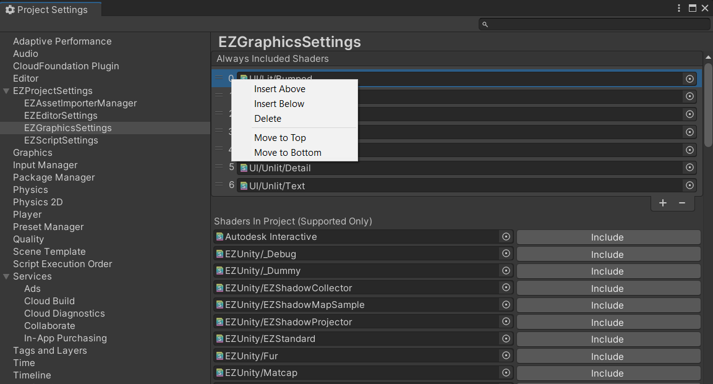
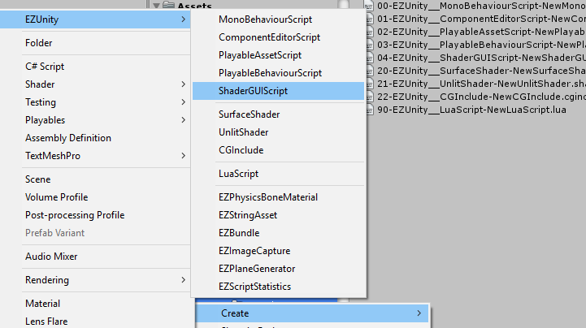
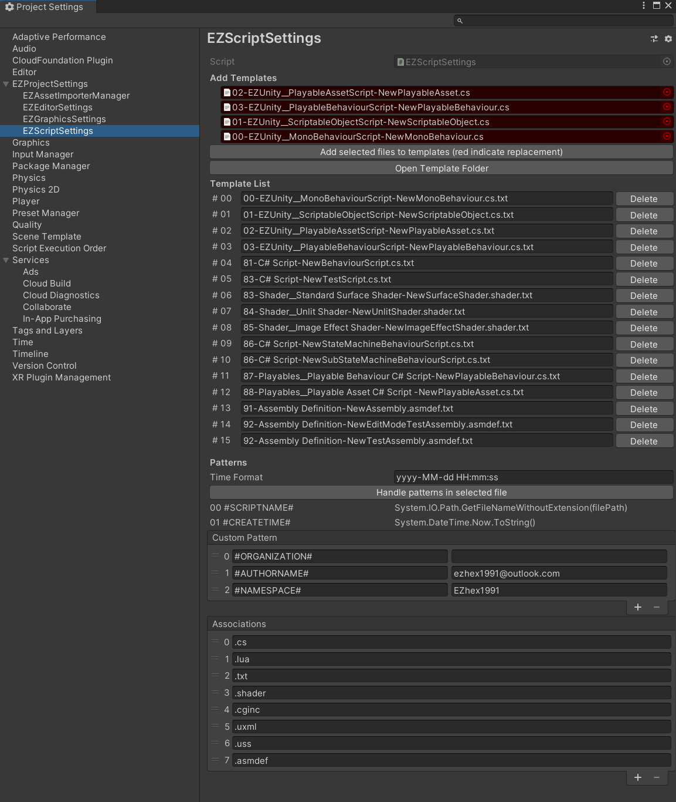

# EZProjectSettings

[中文](README.md)

EZProjectSettings provides project settings extensions for the Unity Editor.

Minimum supported Unity version: `2020.3.x`.

Open the settings from `Edit > Project Settings > EZProjectSettings`.

## Settings

- `EZScriptSettings`: Script templates and file header processing settings.
- `EZAssetImporterManager`: Asset importer Preset settings with automatic Preset application.
- `EZGraphicsSettings`: A convenient interface for managing Always Included Shaders in Graphics Settings.

## Samples

The sample content can be imported from **Window > Package Manager > EZProjectSettings > Samples**.

### EZAssetImporterManager

Manages import settings for Model, Texture, and Audio importers. Default import options can be configured for each asset type, with Presets associated through filename Tags. During asset import, matching Presets are searched from the current directory toward its parent directories and applied automatically.



### EZGraphicsSettings

Provides tools for managing Always Included Shaders, including searching project shaders and adding or removing them from the list.



### EZScriptSettings

Manages Unity script templates in the Editor. Unity stores these templates in `Editor/Resources/ScriptTemplates` inside the Unity installation. After importing the sample, the templates can be managed from the settings panel.



Open `Edit > Project Settings > EZProjectSettings > EZScriptSettings`, then select a matching TextAsset in the Project window to add it to Unity's script template directory. `#SCRIPTNAME#` is replaced with the new script name, `#CREATETIME#` is replaced with the creation time, and additional variables can be defined in Custom Pattern.



The example script templates are located at `Samples~/Demo/ScriptTemplates`.

## Directory Structure

```text
EZProjectSettings/
├── README.md — Chinese module documentation.
├── README_EN.md — English module documentation.
├── Documentation~/Images/ — README and sample images.
├── Samples~/Demo/ScriptTemplates/ — Example script templates.
└── Editor/
    ├── EZProjectSettingsProviders.cs — Registers Project Settings providers.
    ├── EZhex1991.EZProjectSettings.Editor.asmdef — Defines the editor assembly.
    ├── Common/
    │   ├── EZEditorGUIUtility.cs — Common GUI helpers for settings inspectors.
    │   └── EZEditorUtility.cs — Editor resource query helpers for settings.
    └── ProjectSettings/
        ├── _EZProjectSettings.cs — Base implementation for loading and saving project settings singletons.
        ├── EZScriptSettings.cs — Script templates and file header replacement settings.
        ├── EZScriptSettingsEditor.cs — Inspector for script settings.
        ├── EZScriptProcessor.cs — Processes file headers when scripts are created.
        ├── EZAssetImporterManager.cs — Asset importer Preset configuration.
        ├── EZAssetImporterManagerInspector.cs — Inspector for asset importer configuration.
        ├── EZAssetPostprocessor.cs — Automatically applies asset importer Presets.
        └── EZGraphicsSettings.cs — Graphics settings in Project Settings.
```
